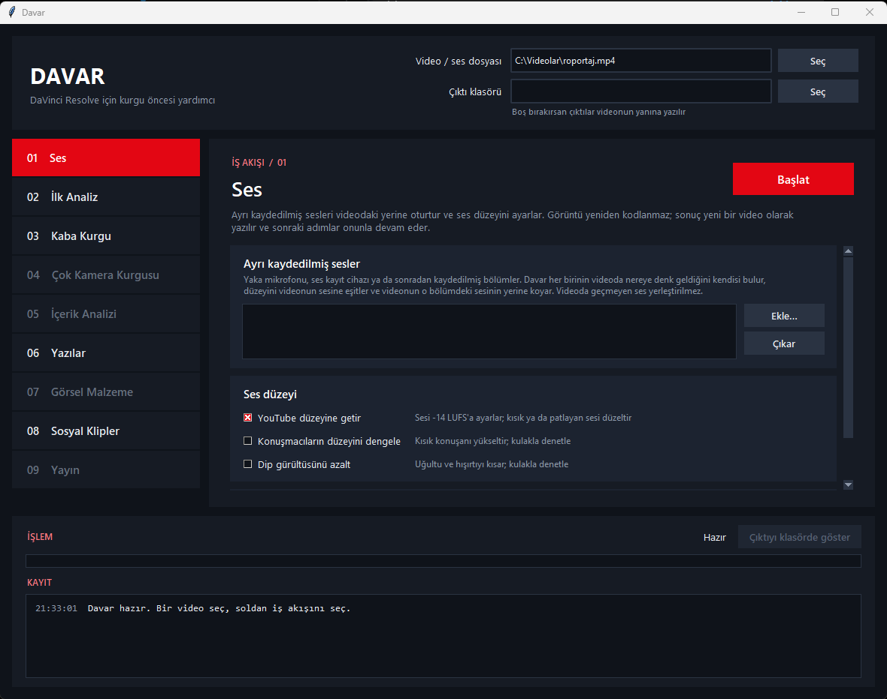

# Davar

DaVinci Resolve için kurgu öncesi yardımcı. Konuşma videolarında elle yapılan sıkıcı işleri üstlenir; dokuz iş akışından üçü çalışıyor, altısı planlandı.

| No | İş akışı | Durum | Ne yapar |
|---|---|---|---|
| 01 | İlk Analiz | çalışıyor | Konuşmayı bir kez, kelime zamanlarıyla yazıya döker ve kaydeder; altyazı (`.srt`) ve metin (`.txt`) üretir |
| 02 | Kaba Kurgu | çalışıyor | Sessizlikleri, "ııı / eee" duraksamalarını ve dolgu kelimelerini bulur; adayları onayına sunar; Resolve çizelgesi (`.fcpxml`) yazar |
| 03 | Ses Kanalı Temizliği | planlandı | Ayrı mikrofonlu kayıtlarda konuşmayan kişinin mikrofonunu kısar |
| 04 | Çok Kamera Kurgusu | planlandı | Kim konuşuyorsa onun kamerasını seçer |
| 05 | İçerik Analizi | planlandı | Konuları, bölüm zamanlarını ve öne çıkan yerleri çıkarır |
| 06 | Yazılar | planlandı | Konuşmacı adı ve konu başlığı için ekran yazıları |
| 07 | Görsel Malzeme | planlandı | Araya girecek fotoğraf ve belgelerin yerleşimi |
| 08 | Sosyal Klipler | çalışıyor | Seçilen aralığı başlık, altyazı ve kapakla dikey Reels / Shorts olarak keser |
| 09 | Yayın | planlandı | YouTube açıklaması, bölüm zamanları, başlık önerileri |

Orijinal videoya hiçbir iş akışı dokunmaz. Resolve'un **ücretsiz sürümüyle** çalışır: Davar Resolve'u dışarıdan yönetmez, Resolve'un içe aktardığı dosyalar üretir.

> **Durum: erken sürüm.** Henüz tek bir kullanıcının birkaç videosuyla denendi. Kesimleri yayınlamadan önce mutlaka izle; hata bulursan konu (issue) aç.

Adı iki yere selam veriyor: **Da**Vinci **R**esolve'a ve bu işin Türkiye'deki öncüsü, İlker Canikligil'in **Katır**'ına.



## 01 İlk Analiz

Konuşmayı kelime kelime zamanlarıyla yazıya döker ve videonun yanına `<video>.davar.json` olarak kaydeder. Diğer iş akışları bu kaydı okur; aynı video yeniden yazıya dökülmez. İstenirse YouTube Studio'ya yüklenebilen altyazı (`.srt`) ve zaman damgalı metin (`.txt`) de yazar.

Yazıya dökme bilgisayarında, Whisper modeliyle yapılır; internete bir şey gönderilmez (model ilk kullanımda bir kez indirilir). Özel adlarda ve sayılarda hata yapar; yayınlamadan önce denetle.

## 02 Kaba Kurgu

| Ne bulur | Nasıl |
|---|---|
| Sessizlikler | Ses seviyesinden. Eşiği kayıttaki arka plan gürültüsüne göre kendisi seçer. Doğrudan kesilir. |
| "Iıı / eee" duraksamaları | Sesin kendisinden (düz perde, sabit ses). İlk Analiz varsa metinle karşılaştırılır. |
| Dolgu kelimeleri | Senin verdiğin listeden ("yani, şey, işte"), İlk Analiz'in metninde aranır. |

Duraksamalar ve dolgu kelimeleri **aday** olarak bir listede gelir: zaman, tür, güven derecesi ve çevresindeki cümle. Her adayı ve kesilmiş halini dinleyebilir, işaretini değiştirebilirsin. Emin olunanlar işaretli, şüpheliler işaretsiz gelir; dolgu kelimeleri her zaman işaretsiz gelir, çünkü hangisinin gereksiz olduğuna sen karar verirsin.

## Kurulum

Gerekenler:

- **Python 3.10** ya da daha yenisi
- **ffmpeg** (`ffmpeg` ve `ffprobe` komutları PATH'te olmalı)
- **numpy** ve **Pillow**
- **faster-whisper** (İlk Analiz ve otomatik altyazı için)

```bash
pip install -r requirements.txt
```

Windows'ta ffmpeg kurmanın kolay yolu:

```bash
winget install Gyan.FFmpeg
```

## Kullanım

### Pencereyle

`Davar.bat` dosyasına çift tıkla. Üstten videoyu (istersen çıktı klasörünü) seç, soldan iş akışını seç, ayarları işaretle, **Başlat**'a bas. İlerleme ve sonuçlar alttaki kayıt bölümünde görünür. Bir videoyu `Davar.bat`'ın üstüne sürükleyip bırakırsan pencere o video seçili açılır.

Windows dışında:

```bash
python davar_arayuz.pyw
```

### Komut satırından

```bash
python analiz.py "video.mp4" --srt --metin
```

```bash
python davar.py "video.mp4" --dolgu "yani, şey" --kontrol
```

Komut satırında onay listesi yoktur: emin olunan duraksamalar ve `--dolgu` ile verilen kelimelerin hepsi kesilir.

Seçenekler:

| Seçenek | Varsayılan | Anlamı |
|---|---|---|
| `--min-sessizlik` | 0.5 | Bundan kısa sessizliklere dokunulmaz (saniye) |
| `--pay-bas` | 0.10 | Kelime başlamadan önce bırakılan pay |
| `--pay-son` | 0.15 | Kelime bittikten sonra bırakılan pay |
| `--esik` | otomatik | Sessizlik eşiği (dB) |
| `--sessizlik-yok` | | Yalnızca duraksamaları kes |
| `--iii-yok` | | Yalnızca sessizlikleri kes |
| `--iii-min` | 0.30 | Bundan kısa duraksamalara dokunulmaz |
| `--iii-sondakiler` | | Kelime sonuna yapışık uzatmaları da kes (yanlış kesim riski yüksek) |
| `--dolgu` | | Kesilecek dolgu kelimeleri, virgülle ayrılmış (İlk Analiz gerektirir) |
| `--kontrol` | | Kontrol çizelgesini de yaz |
| `--cikti` | videonun yanı | Çıktı dosyasının yolu |

### Resolve'a aktarma

1. Resolve'da bir proje aç.
2. **File → Import → Timeline…** ile videonun yanında oluşan `<video>_kesik.fcpxml` dosyasını seç.
3. Çıkan pencerede **OK** de. Edit sayfasında kesilmiş zaman çizelgesi açılır.

Kontrol çizelgesi (`<video>_iii_kontrol.fcpxml`) aynı yolla içeri alınır.

## 08 Sosyal Klipler

Yatay bir videodan verdiğin zaman aralığını 1080x1920 dikey video olarak keser: bulanık arka plan üstünde konuşmacı kadrajı, üstte kısa bir yazı ve iki satıra kadar başlık. İsteğe bağlı olarak konuşmadan otomatik altyazı ve 2,5 saniyelik bir giriş kapağı ekler. Ses yüksekliği sosyal medya düzeyine (-14 LUFS) getirilir.

```bash
python reels.py "video.mp4" 13:06 13:56 --ust-yazi "1. BÖLÜM" --baslik "TUZLA'DA TRAFİK" --baslik "NEDEN KİLİTLENİYOR?" --altyazi --kapak
```

| Seçenek | Anlamı |
|---|---|
| `--ust-yazi` | Başlığın üstündeki kısa yazı |
| `--baslik` | Başlık satırı (iki satır için iki kez yaz) |
| `--yatay` | Kadrajın yatay yeri: 0 sol, 0.5 orta, 1 sağ |
| `--altyazi` | Konuşmadan otomatik altyazı ekle |
| `--kapak` | Başa giriş kapağı ekle |
| `--dil` | Konuşma dili (varsayılan `tr`) |
| `--cikti` | Çıktı dosyası (varsayılan: videonun yanına `<video>_reels.mp4`) |

Altyazı için İlk Analiz'in metni kullanılır; analiz yoksa seçilen aralık o an yazıya dökülür. Özel adlarda ve sayılarda hata yapabilir, şimdilik düzeltme imkânı yok: yayınlamadan önce oku.

## Sessizlik ve duraksama nasıl bulunuyor

**Sessizlik.** Ses 10 milisaniyelik dilimlere bölünür ve her dilimin seviyesi ölçülür. Eşik, kayıttaki arka plan gürültüsü ile konuşma seviyesinin arasına otomatik yerleştirilir. Eşiğin altında yeterince uzun kalan aralıklar, kelimelerin iki yanında küçük bir pay bırakılarak kesilir.

**Duraksama.** "Iıı" sesi konuşmadan üç özelliğiyle ayrılır: ses kesintisizdir (ötümlü), perdesi düz kalır ve ağız şekli değişmez. Normal konuşmada bu üçü aynı anda 0,3 saniye sabit kalmaz. Davar bu kalıba uyan yerleri arar ve iki türünü keser:

- iki yanı sessiz, tek başına duran duraksamalar,
- sessizlikten sonra gelip doğrudan kelimeye bağlanan duraksamalar ("ııı şimdi…").

Kelimenin *sonuna* yapışık uzatmalar çoğu zaman gerçek kelimenin parçası olduğu için varsayılan olarak kesilmez.

Sessizlik ve duraksama bulmak için yapay zekâ modeli ya da internet bağlantısı gerekmez; sesin kendisinden hesaplanır. Bu yüzden İlk Analiz yapılmamış videolarda da çalışır.

## Sınırlar

- Yalnızca en az 0,3 saniye süren, net duraksamalar yakalanır. Çok kısa ya da kısık söylenenler kalır.
- Dolgu kelimelerinin zamanı yazıya dökmeden gelir ve yaklaşıktır; kesmeden önce "kesilmiş halini dinle" ile denetle.
- Arka planı gürültülü kayıtlarda (sokak, rüzgâr, müzik) sessizlik ayrımı zayıflar. Program bu durumda uyarır.
- Kare hızı değişken kayıtlarda (bazı telefon ve ekran kayıtları) Resolve'da kesim yerleri kayabilir. Program bu durumda uyarır.
- Kesimler otomatiktir; yayınlamadan önce izlemek senin işin.

## Yeni iş akışı eklemek

`davar_arayuz.pyw` içinde `Sayfa` sınıfından türeyen bir sınıf yazıp `SAYFALAR` listesine eklemek yeterli; video ve çıktı klasörü seçimi, Başlat düğmesi, ilerleme çubuğu ve kayıt bölümü hazır gelir. Planlanan iş akışları aynı dosyada `Yakinda` sınıfından türeyen taslaklar olarak duruyor.

## Katkı

Hata bildirimi ve öneriler için konu (issue) açabilirsin. Farklı konuşmacılar ve kayıt koşullarıyla denemeler özellikle değerli.

## Lisans

[MIT](LICENSE)
