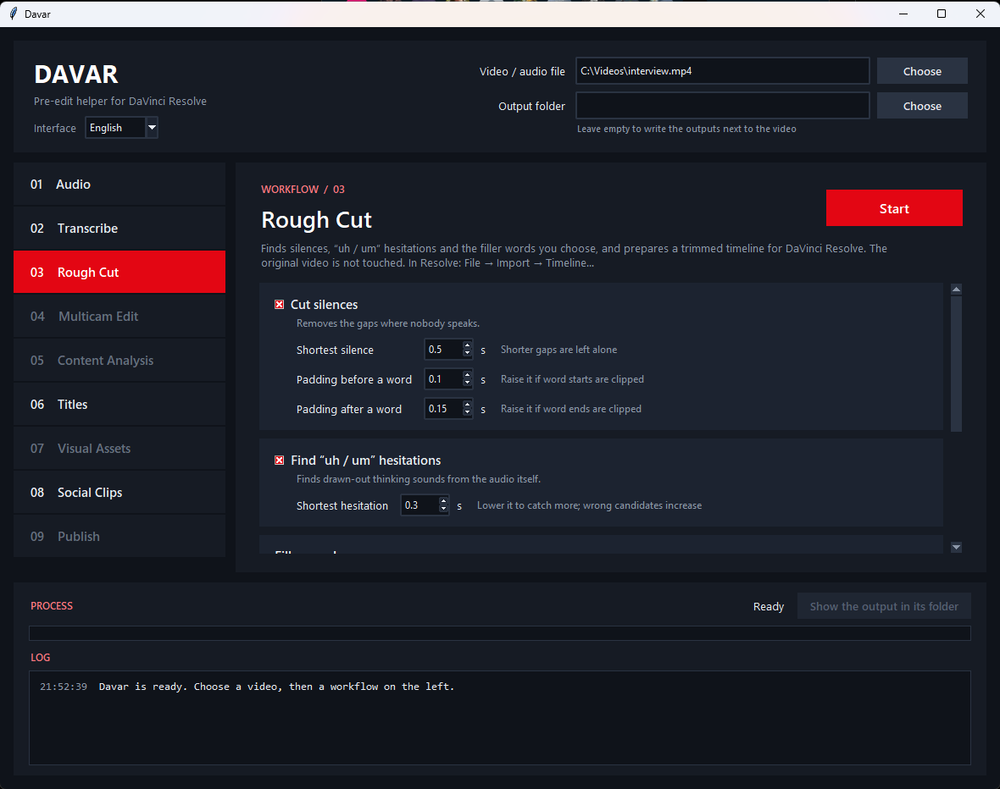

# Davar

DaVinci Resolve için kurgu öncesi yardımcı. Konuşma videolarında elle yapılan sıkıcı işleri üstlenir: ses eşleme, sessizlikleri ve "ııı / eee" duraksamalarını kesme, yazıya dökme, KJ ve dikey klip üretme.

*English: [README.md](README.md)*

> **Durum: erken sürüm.** Henüz tek bir kullanıcının birkaç videosuyla denendi. Kesimleri yayınlamadan önce mutlaka izle; hata bulursan konu (issue) aç.

Adı iki yere selam veriyor: **Da**Vinci **R**esolve'a ve bu işin Türkiye'deki öncüsü, İlker Canikligil'in **Katır**'ına.



## İş akışları

On iş akışından altısı çalışıyor, dördü planlandı.

| No | İş akışı | Durum | Ne yapar |
|---|---|---|---|
| 01 | Ses | çalışıyor | Ayrı kaydedilmiş sesleri videodaki yerine oturtur, ses düzeyini YouTube'a göre ayarlar |
| 02 | Görüntü | çalışıyor | Videoyu 16:9 kadraja getirir ve sehpa çekimini sabitler; arka plan yerinden oynamaz |
| 03 | İlk Analiz | çalışıyor | Konuşmayı bir kez, kelime zamanlarıyla yazıya döker ve kaydeder; altyazı (`.srt`) ve metin (`.txt`) üretir |
| 04 | Kaba Kurgu | çalışıyor | Sessizlikleri, "ııı / eee" duraksamalarını ve dolgu kelimelerini bulur; adayları onayına sunar; Resolve çizelgesi (`.fcpxml`) yazar |
| 05 | Çok Kamera Kurgusu | planlandı | Kim konuşuyorsa onun kamerasını seçer |
| 06 | İçerik Analizi | çalışıyor | YouTube metinlerini seçtiğin bir yapay zekâ sohbetine yazdırır: başlıklar, bölüm zamanlı açıklama, etiketler, sosyal klip adayları |
| 07 | Yazılar | çalışıyor | Konuşmacı adı ve unvanı, bir de konuşulan gündem için saydam zeminli, yumuşak giriş-çıkışlı KJ (alt bant) videoları üretir ve zaman çizelgesine yerleştirir |
| 08 | Görsel Malzeme | planlandı | Araya girecek fotoğraf ve belgelerin yerleşimi |
| 09 | Sosyal Klipler | çalışıyor | Seçilen aralığı başlık, altyazı ve kapakla dikey Reels / Shorts olarak keser |
| 10 | Yayın | planlandı | Kapak görselinin yazısı ve görüntüsü |

Orijinal videoya hiçbir iş akışı dokunmaz. Resolve'un **ücretsiz sürümüyle** çalışır: Davar Resolve'u dışarıdan yönetmez, Resolve'un içe aktardığı dosyalar üretir.

Arayüz Türkçe ve İngilizce; dili pencerenin sol üstünden seçersin.

## Kurulum

Gerekenler:

- **Python 3.10** ya da daha yenisi
- **ffmpeg** (`ffmpeg` ve `ffprobe` komutları PATH'te olmalı)
- **numpy** ve **Pillow**
- **faster-whisper** (İlk Analiz ve otomatik altyazı için)
- **OpenCV** (`opencv-python`, Görüntü'de kadrajı sabitlemek için)

```bash
pip install -r requirements.txt
```

Windows'ta ffmpeg kurmanın kolay yolu:

```bash
winget install Gyan.FFmpeg
```

## Kullanım

### Pencereyle

`Davar.bat` dosyasına çift tıkla. Üstten videoyu (istersen çıktı klasörünü) seç, soldan iş akışını seç, ayarları işaretle, **Başlat**'a bas. İlerleme ve sonuçlar alttaki kayıt bölümünde görünür. Bir videoyu `Davar.bat`'ın üstüne sürükleyip bırakırsan pencere o video seçili açılır.

**Ayarlar hatırlanır.** Hiçbir şeyi iki kez girmen gerekmez; kaydedilecek ya da açılacak bir dosya da yoktur:

- Genel ayarlar (eşikler, paylar, dolgu kelimeleri, işaretli seçenekler, konuşmacı adları) her videoda son bıraktığın gibi gelir.
- Tek bir videoya ait ayarlar (kırpma zamanları, sosyal klibin aralığı, ayrı kaydedilmiş ses dosyaları, çıktı klasörü) o videoyla birlikte saklanır ve videoyu yeniden seçtiğinde geri gelir. Yeni bir videoda bu kutular boş başlar.
- Davar, son çalıştığın video ve sayfa ile açılır.
- Davar'ın başka bir videodan ürettiği video (`konusma.mp4`'ten `konusma_picture.mp4`), kaynağının ayarlarıyla başlar.
- Her sayfadaki **Varsayılanlara dön** düğmesi genel ayarları Davar'ın ilk hâline getirir.

Ayarlar kullanıcı klasöründeki `.davar/settings.json` dosyasında, yalnızca bu bilgisayarda tutulur; adı ya da yeri değişen video baştan başlar.

### Komut satırından

Her iş akışı aynı zamanda bir betiktir:

```bash
python audio.py "video.mp4" --audio "yaka_mikrofonu.wav"
```

```bash
python picture.py "video.mp4" --position 100
```

```bash
python transcript.py "video.mp4" --srt --text
```

```bash
python roughcut.py "video.mp4" --from 0:07 --to 51:19 --remove "50:46-51:03" --fillers "yani, şey"
```

```bash
python titles.py "Halil Özen" "Gazeteci" --video "video.mp4"
python content.py "video.mp4"                     # video_prompt.txt yazar
python content.py "video.mp4" --answer cevap.txt  # video_youtube.txt yazar
```

```bash
python clips.py "video.mp4" 13:06 13:56 --headline "TUZLA'DA TRAFİK" --subtitles --cover
```

Bütün seçenekler için herhangi birini `--help` ile çalıştır.

### Resolve'a aktarma

1. Resolve'da bir proje aç.
2. **File → Import → Timeline…** ile videonun yanında oluşan `<video>_cut.fcpxml` dosyasını seç.
3. Çıkan pencerede **OK** de. Edit sayfasında kesilmiş zaman çizelgesi açılır.

## 01 Ses

Ayrı kaydedilmiş sesleri (yaka mikrofonu, ses kayıt cihazı, sonradan kaydedilmiş bölümler) videodaki yerine oturtur. Yeri kendisi bulur: iki kayıttaki konuşmanın ritmini karşılaştırır, sonra örnek hassasiyetinde hizalar. Uzun kayıtlarda iki cihazın saat farkından doğan kaymayı da ölçüp giderir.

- Her sesin düzeyi videonun sesine eşitlenir ve videonun o bölümdeki sesinin yerine konur.
- Videoda geçmeyen bir ses verilirse yerleştirilmez; hangi sesin reddedildiği raporda yazar.
- Bütün ses YouTube düzeyine (-14 LUFS) getirilir. İstenirse konuşmacı düzeyleri dengelenir ve dip gürültüsü azaltılır.

Görüntü yeniden kodlanmaz; sonuç `<video>_audio.mp4` olarak yazılır. Sonraki adımları bu yeni videoyla yap.

## 02 Görüntü

Telefonla çekilmiş görüntüler için. İki iş yapar; ikisi de ayrı ayrı kapatılabilir.

**16:9 kadraja getirme.** Çoğu telefon 16:9'dan geniş çeker; YouTube'da bu, görüntünün üstünde ve altında siyah bant demektir. Davar bunun yerine yanları keser. Konum, hangi yanın gideceğini söyler: 0 sol kenarı tutar, 50 iki yandan eşit alır, 100 sağ kenarı tutar (yani hepsi soldan kesilir). Yüksekliğe dokunulmaz, bu yüzden görüntü büyütülmez.

**Kadrajı sabitleme.** Sehpadaki telefon da görüntüyü oynatır. Odak ararken mercek hareket eder; görüntünün tamamı büyür, küçülür ve birkaç piksel zıplar. Uzun kayıtta kadraj ayrıca yavaş yavaş kayar. Birkaç saniyede bir kesilen videoda arka plan her kesimde sıçrar. Davar arka planı bütün video boyunca izler, her kareyi tek bir örnek kareye hizalar ve oynayan kenarlar görünmesin diye yaklaşık yüzde bir yakınlaştırır. Kameranın önünde hareket eden insanlar bunu bozmaz: arka plan tek bir konumda birleşir, gerisi dikkate alınmaz.

- Yalnızca hareket etmeyen kamera içindir. Görüntünün genişliğinin birkaç yüzdesinden fazla gezdiği videoyu Davar reddeder.
- Odağın kaçtığı andaki bulanıklık onarılamaz; yalnızca hareket giderilir.
- Sabitleme her kareyi iki kez okur ve videoyu baştan yazar. Videonun süresinin bir-iki katı kadar sürer.
- Değişken kare hızı sabit hıza çevrilir.

Ses olduğu gibi kopyalanır; sonuç `<video>_picture.mp4` olarak yazılır. Orijinal için yapılmış İlk Analiz yeni videoya taşınır, yeniden yazıya dökmek gerekmez. Sonraki adımları yeni videoyla yap.

## 03 İlk Analiz

Konuşmayı kelime kelime zamanlarıyla yazıya döker ve videonun yanına `<video>.davar.json` olarak kaydeder. Diğer iş akışları bu kaydı okur; aynı video yeniden yazıya dökülmez. İstenirse YouTube Studio'ya yüklenebilen altyazı (`.srt`) ve zaman damgalı metin (`_transcript.txt`) de yazar.

Yazıya dökme bilgisayarında, Whisper modeliyle yapılır; internete bir şey gönderilmez (model ilk kullanımda bir kez indirilir). Özel adlarda ve sayılarda hata yapar; yayınlamadan önce denetle.

### Metni düzeltme ve kişisel sözlük

**Metni düzelt** penceresinde metin satır satır gelir; satırı dinleyip düzeltir, Enter ile sonrakine geçersin. Kaydedince altyazı ve metin dosyaları da yenilenir.

Tek kelimelik düzeltmeleri Davar **kişisel sözlüğe** eklemeyi önerir. Sözlük, kullanıcı klasöründeki `.davar/dictionary.txt` dosyasıdır; her satırı `yanlış = doğru` biçimindedir:

```
tuzda = Tuzla
Akbörse = Akköse
top sen = TÜPSAN
```

Sözlük her okunuşta uygulanır: bir kez öğrettiğin kelime sonraki videolarda da, daha önce analiz ettiklerinde de kendiliğinden düzelir. Kesme işaretinden sonraki ekler korunur (`Akbörse'nin` → `Akköse'nin`).

## 04 Kaba Kurgu

| Ne bulur | Nasıl |
|---|---|
| Sessizlikler | Ses seviyesinden. Eşiği kayıttaki arka plan gürültüsüne göre kendisi seçer. Doğrudan kesilir. |
| "Iıı / eee" duraksamaları | Sesin kendisinden (düz perde, sabit ses). İlk Analiz varsa metinle karşılaştırılır. |
| Dolgu kelimeleri | Senin verdiğin listeden ("yani, şey, işte"), İlk Analiz'in metninde aranır. |
| Öksürük ve diğer konuşma dışı sesler | İki sessizlik arasında duran kısa sesler. İlk Analiz varsa, karşılığında kelime yazılmamış ses konuşma dışı sayılır. |

**Kırpma.** Programın başladığı ve bittiği zamanı, bir de aradan atılacak aralıkları (tekrar çekim, yayın dışı konuşma) verebilirsin: dışında kalan her şey atılır. Zamanları seçmene yardım etmek için sayfa, metnin ilk ve son satırlarını gösterebilir. Zamanlar dakika:saniye biçiminde (`16:40.5`) ve videodaki zamanlar olarak yazılır, çizelgedeki değil; `16:40:00` gibi üç sayı saat:dakika:saniye demektir, videonun sonundan sonraki bir zaman kabul edilmez.

**Kesilmiş çizelgenin altyazısı.** Videonun dökümü varsa Kaba Kurgu, kesilmiş çizelgeye uyan bir altyazı da yazar (`<video>_cut.srt`); bitmiş videoyla birlikte yüklenir. Atılan yerlerdeki sözler çıkarılır, kalanlar çizelgedeki zamanlarına kayar. Metin sonradan düzeltilirse bu dosya da yeniden yazılır. İlk Analiz'in yazdığı `.srt` kesilmemiş videoya göredir.

Duraksamalar ve dolgu kelimeleri **aday** olarak bir listede gelir: zaman, tür, güven derecesi ve çevresindeki cümle. Her adayı ve kesilmiş halini dinleyebilir, işaretini değiştirebilirsin. Emin olunanlar işaretli, şüpheliler işaretsiz gelir; dolgu kelimeleri her zaman işaretsiz gelir, çünkü hangisinin gereksiz olduğuna sen karar verirsin. Listenin üstündeki **Göster** seçimi listeyi kesilecekler, kesilmeyecekler, emin olunmayanlar ya da konuşma dışı seslerle sınırlar; **Kesilmeyecekler**'e tek tek bakınca Davar'ın emin olamadığı öksürük ya da boğaz temizleme seslerini bulursun. İşaretini değiştirdiğin satır, yeniden seçim yapana kadar listede kalır.

**Konuşana yaklaşma.** Tek kamerada her kesim konuşanları sıçratır. **Konuşana yaklaş** işaretliyken çizelge, ikinci kamerası olan bir kurgucunun yapacağı gibi kadrajlanır: uzun bir cevapta görüntü konuşana yaklaşır (varsayılan %125, oturduğu yana doğru), kısa atışmalarda herkesi gösterir. Uzun cevabın içinde kadraj yaklaşık yarım dakikada bir, en çok konuşmanın atıldığı kesimde değişir; böylece en büyük sıçramalar gizlenir, öteki kesimler kadrajını korur. Kimin konuştuğu dökümden bulunur; kimin nerede oturduğu Yazılar sayfasına yazılan konuşmacılardan alınır (`Ad Soyad | Unvan | sol`). Orada yazılı değilse iki kişi varsayılır ve yakın kadraj ortada kalır. 51 dakikalık bir söyleşide kadraj 84 kez değişti. Çizelgeyi Resolve'a alırken **Use sizing information** işaretli kalsın; yoksa yakın kadrajlar kaybolur. Yazılar'ın yerleştirdiği isim bantları yerinde kalır.

### Sessizlik ve duraksama nasıl bulunuyor

**Sessizlik.** Ses 10 milisaniyelik dilimlere bölünür ve her dilimin seviyesi ölçülür. Eşik, arka plan gürültüsü ile konuşma seviyesinin arasına otomatik yerleştirilir. Eşiğin altında yeterince uzun kalan aralıklar, kelimelerin iki yanında küçük bir pay bırakılarak kesilir.

**Duraksama.** "Iıı" sesi konuşmadan üç özelliğiyle ayrılır: ötümlüdür, perdesi düz kalır ve ağız şekli değişmez. Normal konuşmada bu üçü aynı anda 0,3 saniye sabit kalmaz. Davar bu kalıba uyan yerleri arar ve ayırır:

- iki yanı sessiz, tek başına duranlar,
- sessizlikten sonra gelip doğrudan kelimeye bağlananlar ("ııı şimdi…"),
- kelimenin *sonuna* yapışık olanlar. Bunlar çoğu zaman gerçek kelimenin parçasıdır; gösterilir ama varsayılan olarak kesilmez.

"Iıı" sesi çoğu zaman birden bitmez, 0,1-0,3 saniye daha kısılarak sürer. Kesim bu kuyruğu, sonraki sesin başladığı yere kadar izler; geride artık kalmaz.

Bunun için yapay zekâ modeli ya da internet bağlantısı gerekmez; sesin kendisinden hesaplanır. Bu yüzden Kaba Kurgu, yazıya dökülmemiş videolarda da çalışır.

### Boğaz temizleme

Sessizlikler arasında duran öksürük ve boğaz temizleme sesleri yukarıdaki gibi sesten bulunur. Konuşmanın ortasındaki boğaz temizleme daha zordur: seviyesi ve perdesi bir sese benzer, döküm de çoğu zaman üstüne bir kelime yazar. **Boğaz temizlemeyi ses modeliyle bul** işaretliyken Google'ın [YAMNet](https://github.com/tensorflow/models/tree/master/research/audioset/yamnet) ses modeli (Apache 2.0, 16 MB; ilk kullanımda bir kez indirilir ve parmak izi denetlenir) sesin her anını tarif eder, Davar'la gelen küçük bir ayırıcı (`models/throat_clearing.json`) da saatte yaklaşık 25 olası yer seçer. Her biri için kesilmeye önerilen parça iki ses düşüşü arasında kalır: çıkarılınca model artık boğaz temizleme duymaz, tek başına dinletilince de boğaz temizleme duyar. Bunların en kısası önerilir; böylece çevresindeki sözler kalır. Bunlar işaretsiz olarak "boğaz temizleme? (dinle)" diye gelir; **Göster → Konuşma dışı sesler** onları listeler. Ayırıcı tek bir programla, kulakla işaretlenmiş 16 boğaz temizleme örneğiyle eğitildi; bazılarını kaçırır, başka sesleri de seçer. Neyin kesileceğine yalnızca sen karar verirsin. Bilgisayarında, faster-whisper ile gelen onnxruntime ile çalışır.

## 06 İçerik Analizi

YouTube metinlerini bir yapay zekâ sohbetine yazdırır: beş başlık önerisi, açıklama, bölümler, etiketler, kısa bir özet ve sosyal klip için üç-beş aday aralık. Anahtar ve ücret gerekmez, çünkü soruyu sen sorarsın:

1. **Başlat** bir istem yazar (`<video>_prompt.txt`) ve kopyalar. İstemde döküm Kaba Kurgu çizelgesindeki zamanlarıyla, kimin ne dediğiyle (konuşmacılar ve unvanları Yazılar sayfasından alınır) ve verdiğin program ve kanal adıyla yer alır.
2. İstemi bir yapay zekâ sohbetine (claude.ai, gemini.google.com, chatgpt.com) yapıştırıp gönder. 45 dakikalık bir söyleşinin dökümü yaklaşık 45.000 karakterdir.
3. Cevabın tamamını kopyala, 2. kutuya yapıştır ve **Metinleri yaz**'a bas. Davar cevabı denetler ve YouTube Studio'ya kopyalanmaya hazır `<video>_youtube.txt` dosyasını yazar.

Zamanlar Kaba Kurgu çizelgesine göre olduğu için bölümler bitmiş videoyla örtüşür. YouTube'un istediği gibi Davar ilk bölümü 0:00'a koyar, birbirine on saniyeden yakın bölümleri atar. Her sosyal klip adayı için kesilmemiş videodaki zamanlar da yazılır; Sosyal Klipler bu zamanları kullanır. Döküm, onu yapıştırdığın yapay zekâ hizmetine gider.

## 07 Yazılar

Konuşmacı adı ve unvanı için KJ (alt bant) üretir: solda vurgu şeridi, üstte ad, altta unvan. Yarım saniyede soldan açılır, sonunda solarak çıkar. Çıktı saydam zeminli bir videodur (ProRes 4444, `lowerthird_<ad>.mov`); Resolve'da videonun üstündeki şeride sürüklersin, ayrıca efekt gerekmez.

Boyut ve kare hızı seçili videodan alınır; süre, yer (sol, orta, sağ) ve vurgu rengi ayarlanabilir.

Her satıra bir kişi yazılır: `Ad Soyad | Unvan`. Konuşmacılar farklı yanlarda oturuyorsa unvandan sonra o adın konumunu yaz; konum yazılmayan satırlar sayfada seçili yeri kullanır. Konum, izleyicinin ekranda gördüğü gibidir: görüntünün solunda oturan kişiye `sol` yazılır.

```
Ayşe Yılmaz | Gazeteci | sol
Ali Demir | Belediye Başkanı | sağ
```

### Adları zaman çizelgesine yerleştirme

**Zaman çizelgesine yerleştir** işaretliyken Davar her adı, o kişi ilk konuşmaya başladıktan birkaç saniye sonra videonun üstündeki şeride de koyar:

- Konuşmacıları **ilk konuştukları sırayla** yaz. Davar sesleri renginden ayırt eder; ilk satıra ilk duyulan sesi, ikinci satıra sonraki yeni sesi verir. Bunun için döküm gerekir.
- Adlar, varsa videonun Kaba Kurgu çizelgesine (`<video>_cut.fcpxml`) eklenir; çizelgeyi Resolve'a yeniden al. Yoksa videonun tamamını içeren bir çizelge yazılır (`<video>_titles.fcpxml`).
- Kayıt bölümü her ad için seçilen anı ve orada söylenen sözleri gösterir; adların yer değiştirdiği böylece hemen görülür. İkisi yer değiştirmişse satırların sırasını değiştir.
- Anı kendin seçmek için videodaki zamanı satıra ekle: `Ayşe Yılmaz | Gazeteci | 0:41`. Konum ve zaman birlikte, istediğin sırayla yazılabilir: `Ali Demir | Belediye Başkanı | sağ | 0:41`.
- Kaba Kurgu yeniden çalıştırıldığında adlar yerinde kalır.

Sesler bilgisayarında, ek bir indirme olmadan ayırt edilir. Sesleri birbirinden belirgin biçimde farklı birkaç kişi için yapılmıştır; konuşma sırasının değiştiği an ancak birkaç saniye yaklaşıklıkla bilinir, ad bu yüzden konuşmacı başladıktan biraz sonra gelir.

### Gündem KJ'leri

Konuşulan soru ya da gündem için bir KJ: görüntünün altında beyaz bir panel, kırmızı sekmede program adı, büyük başlık, altında kırmızı bir satır (konuk için) ve sağda logonuz. İsim KJ'leri gibi soldan açılır, varsayılan olarak 8 saniye kalır.

Her satıra bir tane `zaman | başlık` yaz ya da **İçerik Analizi'nin bölümlerini al** düğmesine basarak yapay zekânın her bölüm için yazdığı ekran başlıklarıyla doldur. Zamanlar Kaba Kurgu çizelgesindeki zamanlardır; her KJ bölümünün üç saniye sonrasında açılır, ekranda isim KJ'si varsa onun bitmesini bekler. Başlığın altına o KJ'ye özel bir satır da eklenebilir: `zaman | başlık | alt satır`. KJ'ler Kaba Kurgu çizelgesine isim KJ'lerinin yanına konur; ikisinden biri yeniden üretilince öteki yerinde kalır.

Görünüm kullanıcı klasöründeki `.davar/brand` marka klasöründen gelir: `fonts` klasöründe Montserrat dosyaları (`Montserrat-ExtraBold.ttf`, `-Bold`, `-SemiBold`) varsa onlar, yoksa yaygın bir kalın yazı tipi kullanılır. Logo, sayfada seçtiğin herhangi bir resimdir.

## 09 Sosyal Klipler

Yatay bir videodan verdiğin zaman aralığını 1080x1920 dikey video olarak keser: bulanık arka plan üstünde konuşmacı kadrajı, üstte kısa bir yazı ve iki satıra kadar başlık. İsteğe bağlı olarak altyazı ve 2,5 saniyelik bir giriş kapağı ekler. Ses yüksekliği sosyal medya düzeyine (-14 LUFS) getirilir.

Altyazı için İlk Analiz'in metni kullanılır; analiz yoksa seçilen aralık o an yazıya dökülür. Altyazı videoya gömülür ve sonradan düzeltilemez; önce metni düzelt.

**Kaba Kurgu'yu uygulama.** Videonun Kaba Kurgu çizelgesi varsa **Kaba Kurgu kesimlerini uygula** (varsayılan olarak açık), Kaba Kurgu'nun kestiği sessizlik, duraksama ve kırpılmış kısımları klipten de çıkarır; altyazı da buna uyar. Verdiğin zamanlar videodaki zamanlar olarak kalır; İçerik Analizi her sosyal klip adayı için bu zamanları yazar. Bir söyleşinin bir dakikalık aralığında 22 kesim klibi 11 saniye kısalttı.

## Sınırlar

- Varsayılan olarak yalnızca en az 0,3 saniye süren, net duraksamalar kesilir. Daha kısaları, metin de aynı yerde duymuşsa öneri olarak gelir.
- Dolgu kelimelerinin zamanı yazıya dökmeden gelir ve yaklaşıktır; kesmeden önce "Kesilmiş halini dinle" ile denetle.
- Arka planı gürültülü kayıtlarda (sokak, rüzgâr, müzik) sessizlik ayrımı zayıflar. Davar bu durumda uyarır.
- Kare hızı değişken kayıtlarda (bazı telefon ve ekran kayıtları) Resolve'da kesim yerleri kayabilir. Davar bu durumda uyarır.
- Konuşmacıları ayırt etme, birbirinden belirgin biçimde farklı seslerde çalışır. Benzer iki ses, aynı anda konuşan kişiler ya da konuşmanın altındaki müzik bir adı yanlış yere koyabilir; kayıt bölümü her yerdeki sözleri gösterir, oradan denetleyebilirsin.
- Kesimler otomatiktir; yayınlamadan önce izlemek senin işin.

## Geliştirme

Kod ve açıklamalar İngilizcedir. Hesap kısmı ve çevirilerin eksiksizliği yapay verilerle sınanır; ffmpeg ya da video gerekmez.

```bash
python -m unittest discover tests
```

Yeni iş akışı ya da yeni dil eklemek için [README.md](README.md) içindeki "Development" bölümüne bak.

## Değişiklikler

Her sürümde nelerin değiştiği [CHANGELOG.md](CHANGELOG.md) dosyasında (İngilizce).

## Lisans

[MIT](LICENSE)
